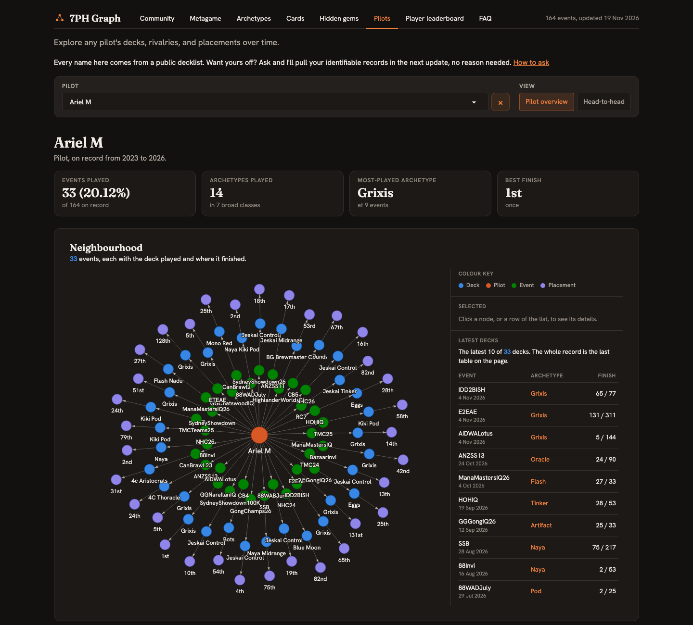
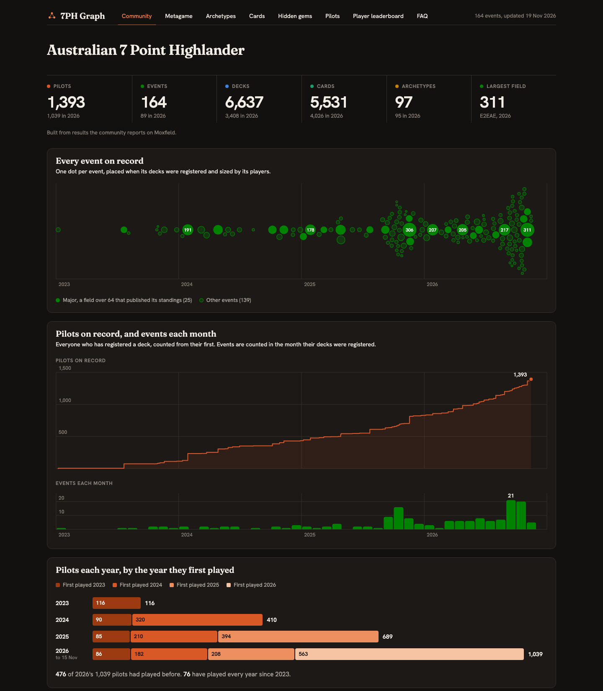

Stats sites for card games answer which decks win and which cards get played. What none of them can tell you is which cards travel together, at which events, and how that has changed. 7PH Graph answers those questions for the Australian 7 Point Highlander format of Magic: The Gathering. It links 164 events, 1,393 pilots, 6,637 decks and 5,531 cards into one knowledge graph, live at 7phgraph.com.

The tournament data behind it is incomplete and sometimes contradicts itself, so I built the graph to be honest about what it knows. Every value the build decides carries the name of the rule that decided it, and no chart draws when the evidence cannot hold it up.

## Links

- **Live explorer:** [www.7phgraph.com](https://www.7phgraph.com)
- **Source:** [7ph-graph on GitHub](https://github.com/AlejandroFuentePinero/7ph-graph)
- **Domain language:** [the domain glossary](https://github.com/AlejandroFuentePinero/7ph-graph/blob/main/CONTEXT.md)
- **Architecture decision records:** [docs/adr/](https://github.com/AlejandroFuentePinero/7ph-graph/tree/main/docs/adr)

<figure>
  <picture>
    <source type="image/webp" srcset="/files/7ph_graph_pilot_page.webp">
    
  </picture>
</figure>

## What it does

- **Opens on the community.** The first page shows every event on record, sized by its players, and how the player base has grown. It splits each year's pilots by the year they first played: 476 of 2026's 1,039 pilots had played before.
- **Maps the metagame**: each archetype's share of the field year by year, and a chart of share against average finish, with an error bar on every point.
- **Gives every archetype, card and pilot a page.** A pilot's page opens with their numbers, then draws their neighbourhood as an interactive graph beside a panel that answers a click on any node. A card's page shows the cards it travels with, year by year.
- **Compares 2 pilots head to head** across the events they both attended, and says so plainly when they never met.
- **Surfaces hidden gems**, the cards that are rare within an archetype yet keep turning up in its best decks. Rare means at most 4% of that archetype's decks, and a gem needs at least 8 decks behind it. The floor is a count, not a share, because a share would let a card in 1 or 2 lucky decks pass as a gem.
- **Ranks pilots on the major events only**, the 25 with a field over 64 that published their standings. Every rank carries the range it could honestly sit in.

When a result is too large to read, the app neither draws it nor cuts it down. It tells you what the query matched and asks you to narrow it, because a truncated graph looks like an answer and is not one. Every name comes from a public decklist, and the app offers to take anyone's name off, no reason needed.

<figure>
  <picture>
    <source type="image/webp" srcset="/files/7ph_graph_community.webp">
    
  </picture>
</figure>

## Architecture

The system splits into 3 commands, and only the first 2 ever talk to the upstream data source:

```sh
graph7ph fetch   # download source data into snapshots/<timestamp>/
graph7ph build   # load the accumulated snapshots into a graph artifact
graph7ph app     # serve the explorer over the prebuilt artifact
```

Each fetch lands as a snapshot that is never edited afterwards, with a copy kept in a private dataset on Hugging Face. The build then folds the whole sequence of snapshots together, checking each one against everything that came before it. If a fact has been quietly rewritten in a later snapshot, the build notices. It holds the fact at its earlier value and reports the change as something for a human to look at, not a notice to scroll past.

The build also decides who is who. The same person can appear under 2 spellings, and one name can hide 2 people. Rules now settle the clear cases at every build, so no human review queue grows between rounds. Archetypes are served as families: a version of a deck joins its parent when the source's own tags say so, and I rule the few cases the tags get wrong.

A new graph artifact is promoted only when it passes validation, and the previous one stays on disk for instant rollback. The app itself never fetches or builds anything. It opens a promoted artifact read-only, which means the deployed instance holds no upstream credential at all.

Midway through the project the vendor archived Kùzu, the embedded graph database underneath everything. I moved to Ladybug, the active fork, and checked the migration against the recorded answer key described below.

## The decision that was hard

The tournament data arrives messy. Some events report a finish only as a band, such as top 8. Others report field sizes that their own deck counts contradict. The easy fix was a yes-or-no flag marking a value as estimated.

I chose something stricter: every uncertain value gets a companion column that names the rule which produced it. The column stays empty when the source's own number stands. One query can then answer: which of this deck's numbers did the build decide, and under which rule? The same column will hold whatever new kind of uncertainty the next season brings.

The design paid for itself fast. A total of 28 decks had a placement but no score on the shared scale, so every ranked average silently dropped them. All but 1 of the 28 were top-8 finishes. The bias ran one way, and it hit hardest the pilots who had made the cut. The pilot pages now mark every number the build worked out, so a reader can tell it from one the source recorded.

## What was measured

Leaderboards invite overconfidence, so I measured how far the standings can be trusted. The test is a bootstrap: redraw every contender's results at random, with replacement, and rescore the whole field 1,000 times. Each rank then carries the band it landed in for 90% of the redraws. Near the top the bands are wide: on 22 November 2026 the leader's ran from 1 to 24 and rank 7's from 2 to 28.

The identity rules were tested against the decisions already on file before any of them ran: 202 pairs merged by hand and 45 rejected or split. A deck-similarity bar alone would have merged 4 of the rejected pairs. Each of those 4 had both names registered at the same event, so a veto on a shared event joined the rule, and the combined rule merges none of them. A false merge fuses 2 people in every figure downstream, while a pair left apart costs nothing, so the rule only acts on the clear cases.

The database migration was checked against a recorded answer key rather than by reading the diff. A baseline file captures what every query answers, along with table counts and dropdown catalogues. The baseline command fails on any difference and refuses to overwrite itself without a force flag, so a regression cannot slip through by being re-recorded.

The visual layer is tested in a real browser rather than by checking the page's markup. A Playwright suite measures what the graph actually draws at desktop width, and an acceptance script walks every tab and state at phone and desktop widths, photographing each one. It then measures every piece of rendered text against the background behind it and grades the contrast at the Web Content Accessibility Guidelines AA level.

## What did not work

An early version of the leaderboard drew each contender's form as a rolling window, and the lines looked convincing. Before shipping it I tested what that shape was made of. The test shuffles each pilot's finishes across their own event dates, which destroys any trace of when they played well while keeping how well they played overall. If the chart were showing form, the shuffle should flatten it.

It did not. The real chart moved by 0.0915 and the shuffled versions by 0.0885, with a 90% range of 0.0823 to 0.0947. The movement on screen was sampling noise dressed up as form. A running score replaced the window. I also renamed the tab from Best player race to Player leaderboard, because the old title asserted exactly what the evidence refused.

An upgrade of Gradio, the interface library, broke the public address in November 2026. The page rendered on the server told the browser to fetch its data over an insecure link, and the browser refused. Rendering in the browser instead fixed it, and on a throttled 5 megabit link it put the title on screen in 2.91 seconds against 4.19.

## Deployment

The app runs as a Hugging Face Space with protected visibility behind [www.7phgraph.com](https://www.7phgraph.com), so the explorer stays reachable while its files stay private. The deployed bundle carries the built graph and the ingestion reports, and a public Space offers both for download.

The page asks no other host for anything. The app keeps its own record of page loads in a private storage bucket, and keeps no address and no user agent, so it counts visits and cannot count people.

## Stack

Python 3.11+ · Ladybug (embedded Cypher graph store) · Gradio · Plotly · pyvis · Pydantic · pandas · pytest · Playwright · uv · Hugging Face Spaces

The repo carries 31 architecture decision records, each a short document recording one design choice and the reasons behind it. A domain glossary gives the code and the interface one shared language. The test suite is larger than the source it covers, about 29,000 lines against 21,000.

## Attribution

Metagame data comes from [7phstats](https://7phstats.com). Decklists link out to [Moxfield](https://moxfield.com), free and non-commercial per Moxfield's API terms. The project is unofficial and not affiliated with either service or with Wizards of the Coast.
