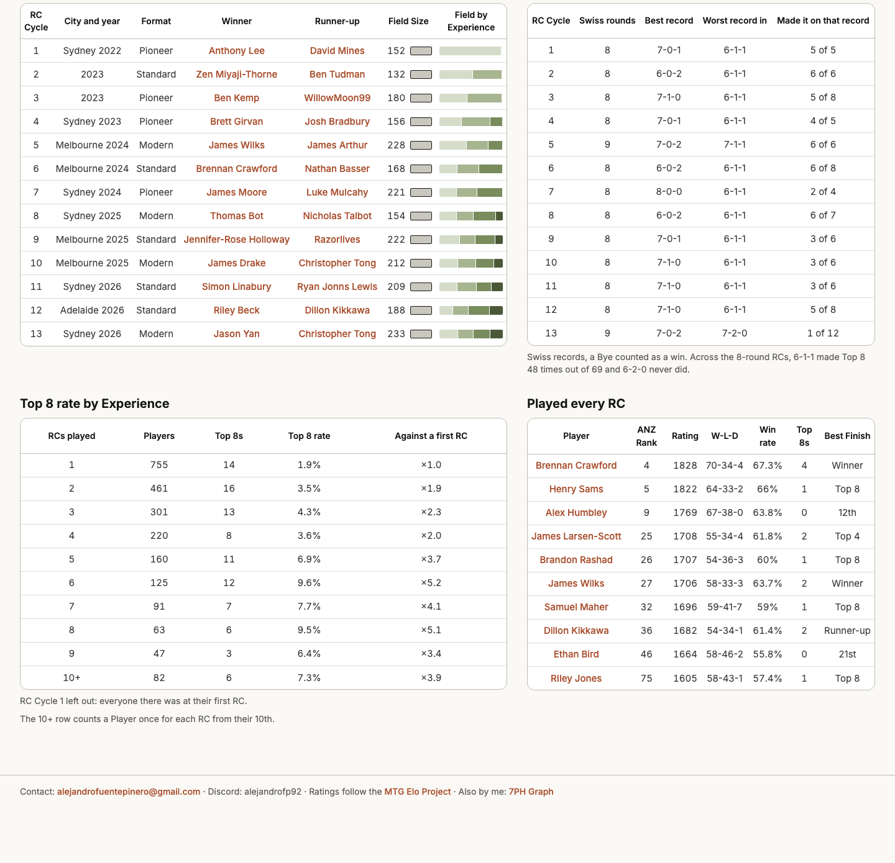

Every player in the 13 Australia and New Zealand (ANZ) Regional Championships (RCs) of Magic: The Gathering now has a rating, a record and a history in one place. ANZ RC Data builds them from every RC's standings and pairings on Melee, the platform the events run on. It covers 907 players and 8,140 rated matches, from Sydney in November 2022 to Sydney in October 2026, across Pioneer, Standard and Modern.

The rating follows the MTG Elo Project, the community's established Elo rating for Magic. I checked my copy against their published numbers before trusting it. Given the same match, it reproduces every one of their rating changes.

## Links

- **Live site:** [www.anzrcdata.com](https://www.anzrcdata.com)
- **Source:** [anz-rc-data on GitHub](https://github.com/AlejandroFuentePinero/anz-rc-data). The repository is public and carries no licence yet.
- **Domain language:** [the domain glossary](https://github.com/AlejandroFuentePinero/anz-rc-data/blob/main/CONTEXT.md)
- **Architecture decision records:** [docs/adr/](https://github.com/AlejandroFuentePinero/anz-rc-data/tree/main/docs/adr)

<figure>
  <picture>
    <source type="image/webp" srcset="/files/anz_rc_data_overview.webp">
    
  </picture>
</figure>

## What it does

- **An overview of every RC**: the winner and runner-up, the field size, and the field split by how many RCs each player had played before. It also shows what record it took to make the Top 8, how the Top 8 rate grows with experience, and the players who played every RC.
- **A leaderboard** ranked by the rating, overall and for each format.
- **A player card** with a player's RCs, finishes, matches and rating over time.
- **A comparison** that sets up to 3 other players beside one player, with every match they played against each other.
- **Player search** by name.

## Architecture

Python 3.12 commands fetch each RC's standings and pairings from Melee and build the ratings and the site's data. The site itself is static pages with vanilla JavaScript.

```sh
anzrc-fetch   # download each RC's standings and pairings
anzrc-build   # rate every match and write the site's data
anzrc-serve   # serve the static site and record page loads
```

A small Starlette server serves the pages and keeps its own record of page loads. It runs on a Hugging Face Space behind its own domain. After each new RC, one command adds it to the site.

The test suite holds about 100 tests. One of them replays every rating from scratch with code written independently of the build, and both must agree.

## The decision that was hard

The obvious way to rank players is by how they finished. My earlier project, [7PH Graph](/projects/7ph-graph/), ranks that way because its source publishes only final standings. A finish gives 1 data point per player per event, and 446 of the 907 players here have played a single RC.

The RCs publish every pairing, so I rank on matches instead. Each match is a data point, about 10 per RC where a finish gives 1. Beating a strong player counts for more than beating a weak one.

I also rejected a Glicko-style rating, which carries an uncertainty term, because the community knows it less well. Instead I follow the MTG Elo Project, which the community already knows and accepts. Everyone starts at 1500, a factor called K, set to 36, scales how far each match moves both ratings, and only the match result counts. Game score, byes and intentional draws move nothing.

The one deliberate difference is the starting point. Everyone starts at 1500 at their first ANZ RC, so a player's number here differs from their number there on purpose.

## What was measured

The check against the MTG Elo Project uses its own published record of the same 13 RCs, 16,378 rows of one player in one match. Given each pair of ratings before a match and its result, my code reproduces every rating after it. Every match they rate, I rate with the same result, except 2. In both, Melee's own result names the other winner, and the repository lists the 2 with that reason.

K was not taken on trust. I scored every value from 16 to 64 by log loss, a measure of how well the ratings before each RC predict the matches in it. None beat 36 by more than 2 standard errors, so 36 stayed.

Each format has its own rating, moved only by that format's matches. With only 4 or 5 RCs per format, each one had to earn its place. A format's rating ships only because it predicts its own later RCs better than chance, and all 3 do.

I also resampled the leaderboard to see how far its order can be trusted. Only about 5 of the top 10 keep their place. The measurement is recorded in the repository, and I chose to show the rank alone.

## Stack

Python 3.12 · Starlette · vanilla JavaScript · pytest · uv · Hugging Face Spaces

## Attribution

Standings and pairings come from [Melee](https://melee.gg). The rating follows the [MTG Elo Project](https://mtgeloproject.net), credited on the site. The project is unofficial and not affiliated with either service or with Wizards of the Coast.

## Role

I designed and built it alone on 21 and 22 November 2026, for the RC scene I compete in.
